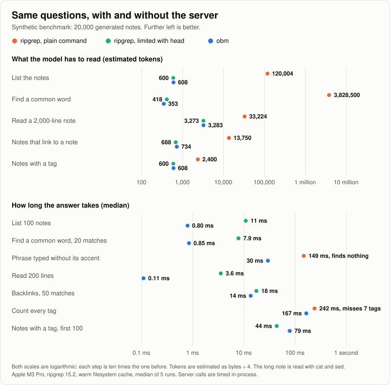
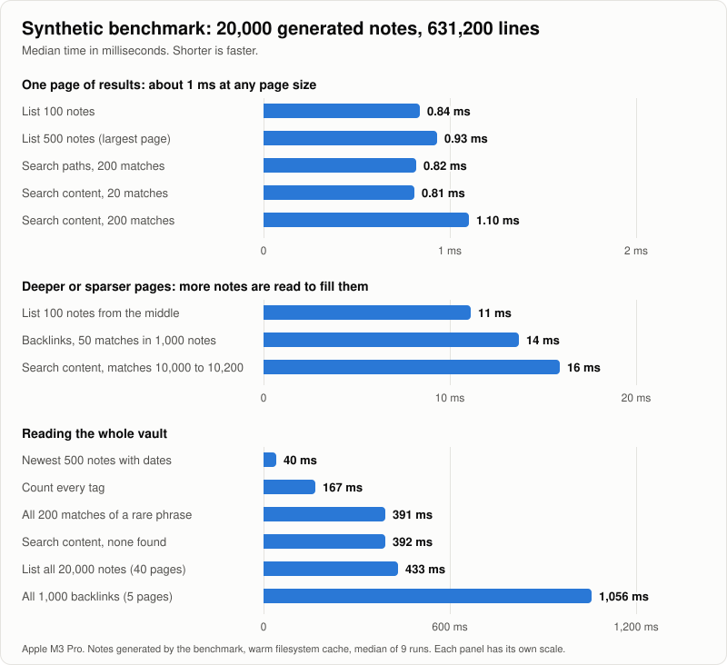

# Obsidian Bridge MCP

Give your AI assistant safe, exact access to your Obsidian vaults. `obm` is a single native binary that speaks MCP over stdio, so it works with Claude, Cursor, Codex, OpenCode, Pi, Copilot, and any other MCP client. It reads the Markdown files in your vault directly: Obsidian does not need to be running, and no plugin, index, Node, or Python is involved.

## Why use it

An assistant can already poke at a vault with shell commands. This server exists because that goes wrong in ways that are easy to measure:

- **It never floods the model.** Every answer is one bounded page that says whether more remains. In our benchmark a plain search for a common word returned 15 MB; `obm` returned 20 matches in 1.4 KB.
- **It finds what `grep` misses.** Search ignores accents as well as case, so `cancion` finds `canción`. Tags are read from frontmatter as well as from the text, and backlinks understand `[[Note|alias]]` and `[[Note#heading]]`. ripgrep got two of our seven benchmark questions wrong; `obm` got none wrong.
- **Edits are exact and hard to get wrong.** A patch must match exactly one place, replacing a whole note can be guarded by its line count, deleting moves the note to `.trash`, and creating, moving, or deleting never overwrites another note.
- **Small models can drive it.** Results are short plain text, and the tools explain themselves. In a manual check, a small model (Claude Haiku) completed 14 of 14 tasks using only the tool descriptions, including following pages to the end and patching one of two identical lines.
- **It is fast.** One page of results takes about a millisecond on a generated vault of 20,000 notes.

It is honest about its limits too: see [Compared with shell commands](#compared-with-shell-commands) and [What it does not do](#what-it-does-not-do).

## What the assistant sees

Results are plain text. The first line is a status; the rest is the answer.

A search groups matching lines under each note:

```text
[3 matching lines; more: offset=3]
Projects/Atlas/Overview.md
  4: Pending review of the budget
  19: pending: deploy to staging
Projects/Atlas/Notes.md
  2: Still pending
```

Reading a note returns its text exactly as stored, so what the model reads is what it can paste into an edit:

```text
[lines 1-200 of 950; more: offset=201]
# Overview
...
```

When something is wrong, the error says how to fix the call:

```text
multiple vaults are configured (BYTE, The Core); pass vault with one of these exact names, or call list_vaults
```

## Installation

### Homebrew (Recommended)

```bash
brew install roter-s/tap/obsidian-bridge-mcp
```

Prebuilt binaries cover macOS and GNU/Linux on ARM64 and x86_64. See [Install and update](docs/distribution.md) for manual downloads and upgrades.

### From Source

```bash
cargo install --path .
```

## Quick Start

1. **Configure your vaults once:**

   ```bash
   obm setup
   ```

   Follow the prompts to add your vault paths (e.g. `The Core=/Users/.../Documents/Obsidian/The Core`). Vaults are saved to `~/.config/obsidian-bridge-mcp/config.json` and shared by every client.

2. **Verify configuration:**

   ```bash
   obm doctor
   ```

3. **Register `obm` in your MCP client** (next section) and ask your assistant to list your vaults.

## MCP Client Configuration (Pi, OpenCode, Claude, Cursor, etc.)

Because `obm` reads your shared configuration, each agent only needs to register `obm` as a **stdio MCP server**, without repeating `--vault` flags. No Rust runtime, Node, Python, skill, or agent-specific wrapper is required to run the installed binary.

Each client has its own configuration format. For example, **OpenCode** uses:

```json
{
  "mcp": {
    "obsidian": {
      "type": "local",
      "command": ["obm"],
      "enabled": true
    }
  }
}
```

For Pi, Codex, or another client, use that client's MCP configuration format with executable `obm` (or its absolute installed path), no arguments, and stdio transport. Restart/reconnect the MCP server after upgrading so the client refreshes instructions and tool schemas. The configured filesystem path must be the vault root, not a project folder.

> **Note**: You can still provide explicit vaults via `--vault NAME=/path` if you want to override the saved configuration for a specific agent.

## Tools

| Tool | What it does |
| --- | --- |
| `list_vaults` | Names of the configured vaults. |
| `list_notes` | Paths in a folder, a page at a time. Optional `details` (date and size, newest first) and `tag` filter. |
| `search_notes` | Literal text in note content or paths, ignoring case and accents. `path_only` skips reading note bodies. |
| `read_note` | 200 lines by default, 500 at most per call, from any starting line. |
| `get_note_outline` | A note's headings with their line numbers. |
| `get_backlinks` | Lines in other notes that link to a note with `[[...]]`. |
| `list_tags` | Tags from text and frontmatter, with the number of notes using each. |
| `create_note` | Creates a note; fails if it already exists. |
| `append_note` | Adds content at the end, always starting on a new line. |
| `patch_note` | Replaces one exact snippet; fails if it is missing or appears more than once. |
| `update_note` | Replaces a whole note; `expected_total_lines` rejects the write if the note is not what was read. |
| `move_note` | Moves or renames a note; fails if the destination exists. |
| `delete_note` | Moves a note to the vault's `.trash`, where Obsidian keeps deleted notes. |

## Compared with shell commands

An agent without this server can still read a vault with ripgrep, `find`, `grep`, `cat`, and `sed`. This benchmark asks both the same questions on the same synthetic vault of 20,000 generated notes and records what comes back: the size the model has to read, and the time.

<picture>
  <source media="(prefers-color-scheme: dark)" srcset="docs/assets/comparison-dark.svg">
  
</picture>

| Question | ripgrep, plain command | ripgrep, limited with `head` | `obm` |
| --- | ---: | ---: | ---: |
| List the notes | 120,004 tokens, 17 ms | 600 tokens, 11 ms | 608 tokens, 0.80 ms |
| Find a common word | 3,828,500 tokens, 295 ms | 418 tokens, 7.9 ms | 353 tokens, 0.85 ms |
| Read a 2,000-line note (`cat`, `sed`) | 33,224 tokens, 3.4 ms | 3,273 tokens, 3.6 ms | 3,283 tokens, 0.11 ms |
| Find the notes that link to a note | 13,750 tokens, 156 ms | 688 tokens, 18 ms | 734 tokens, 14 ms |
| Find the notes with a tag | 2,400 tokens, 153 ms | 600 tokens, 44 ms | 608 tokens, 79 ms |
| Find a phrase typed without its accent | 0 results, 149 ms | | 20 of 200 matches, 324 tokens, 30 ms |
| Count the tags | 50 of 57 tags, 185 tokens, 242 ms | | 57 tags, 185 tokens, 167 ms |

What the numbers say:

- **A plain command can return far more than the model needs.** Searching for a common word returned 15 MB. `obm` always answers with one bounded page and says whether more remains.
- **A carefully limited command reads about as little as `obm`.** Against ripgrep with `head`, `obm` ranges from 16% smaller to 7% larger. The saving comes from being bounded by default, not from a much smaller page.
- **Speed is mixed.** `obm` answered a page of notes or matches 9 to 14 times faster and backlinks slightly faster, but ripgrep was faster at finding the notes with a tag (44 ms against 79 ms).
- **Two ripgrep answers were wrong.** It found nothing for a phrase typed without its accent, and a pattern for inline `#tags` missed the seven tags that exist only in frontmatter.
- **macOS `grep` and `find` are much slower than ripgrep** on the searches: 276 ms for the backlinks page and 526 ms for the notes with a tag. The benchmark prints them too.

Sizes are exact bytes; tokens are estimated as bytes ÷ 4 and vary by model. Server calls are timed inside the process, shell commands include process start, and each is the median of five runs with a warm filesystem cache on an Apple M3 Pro with ripgrep 15.2. Reproduce with:

```bash
cargo test --locked --release tools::benchmarks::shell_comparison -- --ignored --nocapture
```

## Performance

<picture>
  <source media="(prefers-color-scheme: dark)" srcset="docs/assets/benchmark-dark.svg">
  
</picture>

A request for one page of results stops reading as soon as the page is full, so it takes about a millisecond at any page size. A page deep in the results, or one whose matches are spread thinly, reads more notes before it fills. Reading everything costs a pass over the vault, and following the offsets to the end repeats part of that pass on every page.

| Request | 2,000 notes | 20,000 notes |
| --- | ---: | ---: |
| List 100 notes | 0.23 ms | 0.84 ms |
| List 500 notes (largest page) | 0.64 ms | 0.93 ms |
| Search paths, 200 matches | 0.34 ms | 0.82 ms |
| Search content, 20 matches | 0.20 ms | 0.81 ms |
| Search content, 200 matches (largest page) | 0.50 ms | 1.10 ms |
| List 100 notes from the middle of the vault | 1.2 ms | 11 ms |
| Backlinks, 50 matches (1 note in 20 links to the target) | 13 ms | 14 ms |
| Search content, 200 matches starting at match 10,000 | 15 ms | 16 ms |
| Newest 500 notes with dates | 3.3 ms | 40 ms |
| Count every tag | 18 ms | 167 ms |
| Every match of a rare phrase, typed without its accent | 28 ms | 391 ms |
| Search content, none found | 28 ms | 392 ms |
| List every note, 500 per page | 5.3 ms | 433 ms |
| Every backlink, 200 per page | 26 ms | 1,056 ms |

Reading 200 lines from a 100,000-line note takes 3.4 ms; reading 500 lines starting at line 90,000 takes 3.5 ms.

These are medians of nine runs on an Apple M3 Pro against temporary vaults that the benchmark generates (20 folders, notes of 12 to 51 lines, a third of the lines accented; 63,120 and 631,200 lines in total) with a warm filesystem cache. They are not measurements of a real vault. They time the vault operations inside the server, not a cold disk or a full MCP round trip through a client, and they are not a comparison with other servers. Reproduce them with:

```bash
cargo test --locked --release vault::benchmarks::synthetic_vault -- --ignored --nocapture
```

## What it does not do

- **No index.** Every request reads the files as they are now, so results are never stale, but a request that must look at every note grows with the vault. On 20,000 generated notes that is 40 ms to about a second.
- **Literal search only.** No regular expressions, no ranking by relevance, no semantic search.
- **Links are not rewritten.** Moving or deleting a note leaves the `[[links]]` that point to it as they were; the assistant can find them with `get_backlinks` and patch them.
- **Markdown notes only.** Attachments, canvases, and the `.obsidian` folder are out of reach.
- **Not a sandbox, and not a lock.** Path rules keep the assistant inside the vault, but they do not protect it from other processes, and a write does not detect an edit made in Obsidian at the same moment.

## AGENTS.md Convention

The MCP server is self-describing: its initialization instructions include configured vault names, and tool schemas explain browsing, searching, paging, and editing. **A skill is not required** for basic operation in any MCP client.

An optional `AGENTS.md` records project-specific routing that the server cannot infer safely. The MCP server does not read it; the agent reads it and passes the right `vault`, `folder`, and `path`. This avoids repeated cross-vault discovery.

Example:

```md
## Obsidian Project Memory

Use the `obsidian` MCP server for project memory.

- Vault: `The Core`
- Project directory: `Projects/nexus-core-backend`
- Project index: `Projects/nexus-core-backend/00-Overview.md`

For project plan questions, read and search inside `Projects/nexus-core-backend`.
For progress updates, append to `Projects/nexus-core-backend/00-Overview.md`.
```

## Tool Inputs

> **Note**: `vault` is optional across all tools whenever a single vault is configured. With multiple vaults, pass an exact configured name; the server never guesses.

### Efficient agent workflow

1. Use the vault names supplied at MCP initialization; call `list_vaults` if the client does not expose server instructions.
2. Browse a folder with `list_notes`. Do not use `search_notes` with `query: ""`.
3. Search with a **non-empty literal** query; use `path_only: true` when looking for filenames/paths without reading note bodies.
4. Read only relevant lines. `read_note` defaults to 200 lines and clamps `limit` to 1–500. Use outlines when structure is useful, not automatically before every small read.
5. Prefer `patch_note` for a small unique edit, `append_note` for additions, and `update_note` only for an intentional full replacement, with `expected_total_lines` from your last read.
6. `delete_note` moves a note to `.trash`; `move_note` renames or restores it.

Every result is plain text whose first line is a bracketed status such as `[20 notes; more: offset=20]` or `[3 notes; end]`. The count is for this page. When the status says `more: offset=N`, pass that offset with the same filters to continue. List, search, backlink, and tag offsets are **zero-based result counts**. `read_note` uses **1-based line offsets** and reports them the same way, as in `[lines 1-200 of 950; more: offset=201]`. Do not fetch more pages unless the task needs them.

See the [usage guide](docs/usage.md) for tool examples, pagination, targeted edits, and troubleshooting.

`list_vaults`

```json
{}
```

`list_notes`

```json
{
  "vault": "The Core",
  "folder": "Projects/nexus-core-backend",
  "limit": 100,
  "details": false
}
```

`read_note`

```json
{
  "vault": "The Core",
  "path": "Projects/nexus-core-backend/00-Overview.md",
  "offset": 1,
  "limit": 50
}
```

`get_note_outline`

```json
{
  "vault": "The Core",
  "path": "Projects/nexus-core-backend/00-Overview.md"
}
```

`patch_note`

```json
{
  "vault": "The Core",
  "path": "Projects/nexus-core-backend/00-Overview.md",
  "old_text": "status: draft",
  "new_text": "status: active"
}
```

`search_notes`

```json
{
  "vault": "The Core",
  "folder": "Projects/nexus-core-backend",
  "query": "pendiente",
  "limit": 20,
  "path_only": false
}
```

`get_backlinks`

```json
{
  "vault": "The Core",
  "path": "00-Overview.md",
  "limit": 50
}
```

`list_tags`

```json
{
  "vault": "The Core"
}
```

`create_note`, `append_note`

```json
{
  "vault": "The Core",
  "path": "Projects/nexus-core-backend/Bitacora.md",
  "content": "# Bitacora\n"
}
```

`update_note`

```json
{
  "vault": "The Core",
  "path": "Projects/nexus-core-backend/Bitacora.md",
  "content": "# Bitacora\n\nNueva versión completa.\n",
  "expected_total_lines": 12
}
```

`move_note`

```json
{
  "vault": "The Core",
  "path": "Projects/nexus-core-backend/Bitacora.md",
  "new_path": "Projects/nexus-core-backend/Archivo/Bitacora-2026.md"
}
```

`delete_note`

```json
{
  "vault": "The Core",
  "path": "Projects/nexus-core-backend/Borrador.md"
}
```

## Safety Rules

- Only configured vaults are accessible, and with several vaults the server never picks one for you.
- Note paths must be relative and end with `.md`. Absolute paths and `..` are blocked.
- `.obsidian` access is blocked, and symlinks are rejected.
- Folders whose names start with a dot, such as `.trash` and `.git`, are skipped unless you name one as `folder`.
- `create_note` and `move_note` fail if the destination already exists, even when two writers race.
- `append_note`, `patch_note`, and `update_note` require the note to exist. Patches and updates replace the file atomically, and on macOS and Windows keep its creation date.
- `patch_note` refuses a snippet that is missing or appears more than once, and reports the lines where it appears.
- `delete_note` moves the note to `.trash` instead of removing it, and never overwrites a note already there.
- Arguments a tool does not define are rejected instead of ignored.

## Development

```bash
cargo fmt
cargo test
cargo clippy --all-targets --all-features -- -D warnings
```

Contributor rules live in [AGENTS.md](AGENTS.md).
